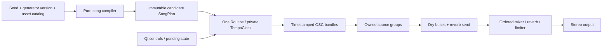

# Architecture and implementation contracts

## Decision

Use a **pure seeded song compiler followed by a single bar-aware playback Routine on a private TempoClock**. The compiler builds a complete, finite arrangement of candidate events. Playback filters candidates using the current controls and sends timestamped OSC bundles. It does not compose notes with live random streams.

Implementation notes for 0.1.1: `Compose.scd` exposes `compile`, `validatePlan`, `canonical`, and `barView`; the small Arrange function lives in that module. `Sound.scd` exposes `definitions` and `makeMessage`; `Assets.scd` exposes `inspectManifest`, `attachCatalog`, `loadBuffers`, and `release`. Engine's `newBeat` implements the regeneration request. The interface table below preserves the original design names; README/test scripts use these actual entry points. GUI operations are deferred to AppClock. Open hats have a dedicated subgroup, and forced-release bundles target owned groups so finite voices expiring before the bundle timestamp do not produce stale-node errors. Scoped Stop still drains queued bundles before releasing the groups and buses.

Patterns/Pbind are good general-purpose sequencing tools, but several independently randomized streams make cross-part composition, repeatable fingerprints, bar commits, and cancellation harder to inspect here. A server-side step sequencer would add coordination and GUI synchronization work. One explicit timeline is the smaller architecture for this constrained generator. No external extensions are needed.



## Planned project tree

These are Luna's implementation deliverables; only the seven design Markdown files currently exist.

```text
main.scd                       # single-block IDE entry point, relative path bootstrap
lib/Config.scd                 # constants, validation, seed/config overrides
lib/Assets.scd                 # catalog, manifest validation, async buffer lifecycle
lib/Sound.scd                  # stock SynthDefs and shared voice-message adapter
lib/Compose.scd                # deterministic song compiler, canonical serialization
lib/Arrange.scd                # section expansion, masks, phrase variation, bar filtering
lib/Engine.scd                 # state machine, clock/Routine, audio ownership
lib/UI.scd                     # Qt views; no musical random decisions
tests/run.scd                  # headless language checks; explicit exit status
tests/render.scd               # NRT checks, shared planner and SynthDefs
tests/lifecycle.scd            # real-server integration checks
tests/manual.md                # GUI, hardware, listening checklist and results
assets/manifest.tsv            # header-only until approved samples are imported
assets/optional/               # optional imported one-shots
renders/                       # generated, ignored
test-results/                  # generated, ignored
README.md                      # install, launch, controls, seeds, troubleshooting
.gitignore                     # generated files only; preserve user assets
```

Use `.scd` modules returning Events/Dictionaries of functions, loaded relative to `thisProcess.nowExecutingPath`. Do not require custom `.sc` classes or a class-library recompile. Use explicit `module[\function].value(...)` dispatch, not Event method names that may collide with built-ins. GUI callbacks capture the controller lexically; they do not rely on whichever Environment is current later. The one public session reference is `~ckg`; launch captures an existing controller before replacing it and awaits its disposal.

## Data contracts

The following tables are language-neutral schemas, not executable sclang. Implement them with Events, Arrays, Symbols, and numbers. A builder owns each plan until publication; after publication it is read-only. Engine/session IDs and server buffer numbers never enter the musical plan.

### Config and catalog

Config: `schemaVersion=1`, `generatorVersion="0.1.0"`, optional `seed` positive integer <= 2147483646 (nil means fresh), `tempo=140`, `activity=0.50`, `intensity=0.55`, `gui=true`, `autoplay=true`, and optional audio device/sample-rate overrides. Validate finite numbers, supported ranges, and writable output paths; do not silently accept NaN, strings as numbers, or invalid seeds. Normal launches select a fresh positive seed outside the previous seed; seed overrides deliberately allow reuse.

Catalog entries: stable `assetId`, role, mode (`synth` or `sample`), patch ID, optional buffer handle, channel count, root MIDI if pitched, and content identity (generator patch version or SHA-256). Sort by assetId before generation. Absolute filesystem paths and load order must not affect seeded choices. Normal core playback uses a fixed synthesized catalog.

### SongPlan

| Field | Contract |
| --- | --- |
| schemaVersion, generatorVersion, seed | recorded immutable generation inputs |
| tonicPc, scale | integer 0–11 and `[0,2,3,5,7,8,10]` |
| ticksPerBeat, ticksPerBar | 96 and 384 |
| harmonicDegrees | one of the two four-entry cycles in MUSICAL_SPEC |
| motif, kickTemplateId, paletteId | original four-bar motif, selected two-bar rhythm, fixed song timbres |
| sections | ordered records `{id, type, startBar, bars}`; contiguous 80 or 96 bars |
| bars | array of `{index, sectionId, localBar, chordRootDegree, candidates}` |
| assetIdentities | sorted role/assetId/content-identity tuples, no buffers or absolute paths |
| canonicalPlan | serialization defined below, independent of runtime handles |

Each candidate event has:

| Field | Contract |
| --- | --- |
| id | deterministic integer, unique within plan |
| tick | integer 0–383, local to its bar |
| role | kick, snare, hatClosed, hatOpen, perc, cymbal, bass, lead, pad, or upper |
| patchId, assetId | catalog keys, never arbitrary server IDs |
| midi | integer for pitched voices; nil for unpitched percussion |
| lengthTicks | positive integer for pitched voices, including release budget; nil for fixed-duration drums |
| velocity | number 0–1 |
| pan | number -0.25–0.25; bass/kick zero |
| minActivity | one of 0.00, 0.25, 0.65, 0.85 |
| minIntensity | 0.65 for upper, otherwise 0.00 |

Section masks and planned transition/dropout decisions are expanded during composition. No muted-section events survive except potential control-gated events that are valid in that section. `barView(plan, barIndex, controls)` applies both thresholds, removes closed hats at playing open-hat onsets, resolves remaining collisions, and sorts by `(tick, roleOrder, id)`. A later closed hat forces a short release on current open hats. Role order is fixed: kick, bass, snare, hatClosed, hatOpen, perc, cymbal, pad, lead, upper. Group control messages precede voice creation at the same timestamp.

Validate duration clipping at every bar boundary as well as harmony/mute boundaries during expansion, before playback. Pads retrigger once per bar; no pitched voice sustains across a bar in v1. This ensures a next-bar tempo change cannot make old-second-based pitched durations overlap new notes/harmony. Tempo converts note durations to seconds only at dispatch. Drum envelopes use patch-defined seconds and may retain tails. The bass adapter includes its attack and release within the time until the next active bass event/bar end, with a 2 ms gap. Primary lead is monophonic; pads are a maximum of three voices. A New Beat forced-release overlap is allowed for 30 ms only.

### Determinism and serialization

Run compilation in a dedicated Routine whose `thisThread.randSeed` is set to the requested seed before any random operation. Obtain the result synchronously using a single yield/next exchange; never wait, read wall-clock time, allocate server objects, or access GUI state inside composition. Iterate fixed role arrays and sorted catalog entries; never depend on Dictionary enumeration order. Keep random choices out of SynthDef construction for musical pitch/timing decisions.

Canonical serialization is a nested array with fixed field order: `[schemaVersion, generatorVersion, seed, tonicPc, scale, harmonicDegrees, motif, kickTemplateId, paletteId, assetIdentities, sections, bars]`. Serialize each record using its schema order above, excluding runtime handles and the `canonicalPlan` field itself. Store decimal control/velocity/pan values at fixed six-decimal precision. Compare canonical strings directly in tests; a digest is optional. A second structural signature omits the seed field so distinct seeds are not deemed musically different merely because their IDs differ.

A full plan comparison with the same inputs must be identical. Filtering the same plan/controls must also be identical, including after unrelated GUI/random operations. This guarantees composition, not bit-identical analog/noise output. Changes to generation order or patch content require a generator/patch version update.

## Module interfaces

Functions close over owned state; argument lists below do not include an implicit `self`.

| Module | Required functions |
| --- | --- |
| Config | `validate(raw) -> config`; `freshSeed(previousSeed) -> integer` |
| Assets | `catalog(config) -> entries`; `load(server, token, done, fail)`; `release(done)` |
| Compose | `makePlan(seed, catalogIdentity) -> SongPlan`; `validatePlan(plan) -> failures`; `canonical(plan) -> String` |
| Arrange | `barView(plan, index, controls) -> sorted events`; no mutation or randomness |
| Sound | `definitions() -> SynthDef array`; `voiceMessages(event, context) -> OSC message array` |
| Engine | `initialize(config, done, fail)`; `start()`; `stop(done)`; `requestNewBeat(seedOrNil)`; `setPending(controlEvent)`; `dispose(done)`; `snapshot() -> diagnostic state` |
| UI | `open(controller)`; `refresh(snapshot)`; `close()` |

`voiceMessages` takes output buses, group targets, resolved asset/buffer mappings, active tempo/intensity, and node IDs as explicit context. It returns OSC data without scheduling. Both real-time dispatch and NRT rendering use this adapter and the same SynthDefs/barView; tests must not synthesize an unrelated toy patch.

Headless plan tests load Config/Compose/Arrange without opening Qt windows or booting a server. `snapshot` exposes owned node/bus/buffer identifiers, active/pending seed and controls, state, generation token, and transport counts without global resource resets.

## Initialization sequence

1. Resolve the project root from the executing file. Capture and dispose the previous `~ckg`; do not overlap old/new controllers. Load modules and validate configuration. Confirm `Main.version` and the scsynth binary's version are 3.14.1; report mismatch before claiming target compatibility.
2. If an output override is requested, apply it before boot. Do not reboot a server already being used elsewhere to force new options; report the mismatch and how to restart deliberately. Reuse a compatible running default server; otherwise `waitForBoot` initiates boot itself. Set an explicit failure callback and a bounded boot wait (about 20 s).
3. Start initialization in a Routine. Send SynthDefs, then `server.sync`. Load approved optional buffers, await completion, and sync again. A sync alone does not prove a failed file load succeeded: check frame count, channels, and failure replies; substitute synth fallback as needed.
4. Compile and validate the plan using the resolved catalog. Install only this controller's CmdPeriod/ServerQuit hooks and scoped OSC failure monitoring. Store callback references for removal. Create UI on AppClock. Keep startup disabled/loading until ready.
5. On automatic Play, allocate a private clock and play graph, await its setup sync, then start the single playback Routine at its bar zero. Announce Ready/Playing only after setup succeeds. No samples or SynthDefs may race the first note.

Every async callback captures a monotonically increasing generation token. If the token no longer matches, it must not restart playback, publish a plan, or edit a disposed window. Resources allocated by a stale load still need explicit cleanup after that load completes. Track outstanding loads and await them before final disposal.

## Scheduling and controls

The engine owns its TempoClock; never set or stop TempoClock.default. Clock tempo is BPM/60 and each bar has four beats. The one playback Routine executes this conceptual loop:

1. At bar tick zero, snapshot/coalesce pending settings; commit tempo there from the clock's own thread. If a prepared New Beat is pending, adopt it, reset the arrangement to Intro bar zero, and prepend a 30 ms forced release for existing voices to the boundary bundle.
2. Compute `barView`, group events sharing a tick, and wait successive **tick differences / 96** beats. At each tick send all corresponding messages with `server.makeBundle(server.latency, {...})` or an equivalent `listSendBundle`. A 0.20 s server latency is the standalone default; respect a compatible existing server's configured latency and record it.
3. Wait the remainder of four beats before the next bar. Advance the arrangement modulo its total bars. Never reset the clock's beat position every bar and never convert the whole future arrangement to absolute seconds.

Compile a requested new plan outside the musical clock callback. Keep only the latest pending request, using tokens to discard obsolete results. If compilation finishes too late for a boundary, show Pending and use the following boundary. A setting accepted before a boundary snapshot commits there; one arriving afterward commits at the following bar. GUI display updates are deferred onto AppClock. Do not block the musical clock with downloads, disk access, long logging, GUI operations, or compilation.

Server bundle lookahead remains bounded to the current event's configured latency. A request on the GUI side becomes audible after its musical boundary plus server latency and limiter delay. Old tails keep their original envelope seconds; all new durations use committed BPM.

## Audio graph and synthesis

Allocate a private root Group under the default group, with `sourceGroup` before `masterGroup`; inside sources keep drum, open-hat, bass, and music subgroups. Use private stereo buses for drums, bass, music, and reverb send (8 audio channels). Instruments write only those buses. One master synth reads them after sources, adds `FreeVerb2` on the send, removes DC, high-passes at 20 Hz, applies fixed gain, and limits at 0.89 before writing hardware outputs 0/1. Reverb is wet-only with modest fixed return; use room 0.35, damping 0.6 and initial return 0.12. No bus routes back into itself. No other project voice writes directly to output 0.

Standard UGens suffice: SinOsc, Saw/Pulse, WhiteNoise/PinkNoise, EnvGen/Env, HPF/LPF/BPF, Pan2, In/Out, FreeVerb2, LeakDC, Lag, and Limiter. Optional sample playback uses separate mono/stereo PlayBuf SynthDefs, fixed channel counts, and BufRateScale. Every voice has finite lifetime with Done.freeSelf, a `gate` control wired to its amplitude EnvGen, and forced-release support. Use negative gate (`-1.03`) to force a 30 ms release at New Beat; gate 0 alone does not release a fixed-length Env.perc/Env.linen.

Patch recipes, envelope limits, and source gain ranges are in ASSETS.md/MUSICAL_SPEC.md. Use a deterministic oscillator for pitched sub bass; synth noise is allowed for percussion texture. Keep the primary plan free of server-side random pitch, pattern, or arrangement decisions. Target <=64 concurrent voice synths, with per-role caps and self-freeing tails; investigate CPU rather than silently dropping musical parts.

## Lifecycle and resource ownership

States: `loading -> ready -> playing -> stopping -> ready`; `error` is recoverable only through an explicit initialize/retry; `disposing -> disposed` is terminal. Initial successful loading auto-starts unless autoplay=false. Start while playing is a no-op; Start while stopping waits for cleanup. Stop while ready is a no-op. New Beat while ready replaces the plan but leaves transport stopped.

Stop increments the playback token, stops the Routine/private clock, clears pending regeneration, and ramps master gain to zero over 30 ms. **Already-sent future OSC bundles cannot be recalled by stopping a Routine.** Keep their groups/buses alive while draining for at least server latency + 30 ms + two audio blocks + 50 ms. Then free the owned root, sync in a cleanup Routine, and return bus indices to the allocator. Retain loaded buffers/catalog for Play; a fresh play graph starts the current plan at its intro. Never reuse freed bus/group IDs while stale bundles could still arrive.

Dispose additionally invalidates initialization/plan tokens, drains outstanding loads, frees owned buffers after nodes are gone, removes this controller's OSC responders and hooks, and closes its window on AppClock. It must be idempotent, including recursive onClose. Do not use `Server.freeAll`, `CmdPeriod.removeAll`, global clock clearing, or unconditionally quit the shared server.

On New Beat while playing, the boundary bundle force-releases the existing source voices before new voice messages. The mixer and buses stay alive, so reverb decays naturally. Retiring voices self-free after 30 ms; bounded crossfade overlap is expected. Closed hats use the same mechanism on the open-hat subgroup with a 10 ms release.

CmdPeriod must stop this engine's scheduler and leave the window showing Stopped; no hidden auto-restart. It may have already removed server nodes. Server quit/loss marks handles invalid, stops scheduling, and reports an error. Use the server lifecycle hook plus bounded server-status checks; hooks alone have documented platform caveats. After server loss/reboot, do not send free messages for stale IDs into the new server incarnation. Reinitialize the catalog/graph from scratch on explicit retry.

## API verification against 3.14.1

The following official tagged files were retrieved on 2026-10-17. This confirms documented/source-level availability, **not a successful application run**. Base URL for all class help links is the exact release tag, not moving `develop` documentation.

| Requirement | Verified official source and relevant behavior |
| --- | --- |
| Version exists | [3.14.1 release](https://github.com/supercollider/supercollider/releases/tag/Version-3.14.1); [Main.sc](https://github.com/supercollider/supercollider/blob/Version-3.14.1/SCClassLibrary/DefaultLibrary/Main.sc) defines Main.version |
| Musical clock | [TempoClock](https://github.com/supercollider/supercollider/blob/Version-3.14.1/HelpSource/Classes/TempoClock.schelp): tempo in beats/sec, schedAbs in beats, stop/clear, tempo changes invalidate precomputed future seconds |
| Boot/synchronization/bundles | [Server](https://github.com/supercollider/supercollider/blob/Version-3.14.1/HelpSource/Classes/Server.schelp): waitForBoot boots when needed, failure callback, sync inside Routine, makeBundle latency semantics |
| Seed ownership | [Thread](https://github.com/supercollider/supercollider/blob/Version-3.14.1/HelpSource/Classes/Thread.schelp): per-thread randSeed/randData; [Routine](https://github.com/supercollider/supercollider/blob/Version-3.14.1/HelpSource/Classes/Routine.schelp) |
| Async sample loading | [Buffer](https://github.com/supercollider/supercollider/blob/Version-3.14.1/HelpSource/Classes/Buffer.schelp): read/readChannel, completion/action, free; [SoundFile](https://github.com/supercollider/supercollider/blob/Version-3.14.1/HelpSource/Classes/SoundFile.schelp) for metadata |
| Graph order and ownership | [Group](https://github.com/supercollider/supercollider/blob/Version-3.14.1/HelpSource/Classes/Group.schelp), [Bus](https://github.com/supercollider/supercollider/blob/Version-3.14.1/HelpSource/Classes/Bus.schelp), [NodeWatcher](https://github.com/supercollider/supercollider/blob/Version-3.14.1/HelpSource/Classes/NodeWatcher.schelp) |
| Qt/lifecycle | [Window](https://github.com/supercollider/supercollider/blob/Version-3.14.1/HelpSource/Classes/Window.schelp): onClose; [AppClock](https://github.com/supercollider/supercollider/blob/Version-3.14.1/HelpSource/Classes/AppClock.schelp); [CmdPeriod](https://github.com/supercollider/supercollider/blob/Version-3.14.1/HelpSource/Classes/CmdPeriod.schelp); [AbstractServerAction](https://github.com/supercollider/supercollider/blob/Version-3.14.1/HelpSource/Classes/AbstractServerAction.schelp): register/remove with server scope and platform caveats |
| Envelopes | [EnvGen](https://github.com/supercollider/supercollider/blob/Version-3.14.1/HelpSource/Classes/EnvGen.schelp): negative-gate forced release, fixed versus sustaining envelopes |
| Sample playback | [PlayBuf](https://github.com/supercollider/supercollider/blob/Version-3.14.1/HelpSource/Classes/PlayBuf.schelp) and [BufRateScale](https://github.com/supercollider/supercollider/blob/Version-3.14.1/HelpSource/Classes/BufRateScale.schelp) |
| Output protection | [Limiter](https://github.com/supercollider/supercollider/blob/Version-3.14.1/HelpSource/Classes/Limiter.schelp): lookahead adds twice dur to latency |
| Offline rendering | [Score help](https://github.com/supercollider/supercollider/blob/Version-3.14.1/HelpSource/Classes/Score.schelp) and [Score.sc](https://github.com/supercollider/supercollider/blob/Version-3.14.1/SCClassLibrary/Common/Control/Score.sc): recordNRT invokes scsynth asynchronously; score serialization scales timestamps by the supplied/default clock |

## Offline rendering contract

Implement NRT in a separate test-language process. Use the same plan, filtering, message adapter, graph, and SynthDefs; assign deterministic offline node/bus IDs. Convert ticks to seconds for the selected **fixed** test BPM, add 0.10 s preroll for graph/definition setup, and allow 2 s for release/reverb at the end. Supply synth definitions before any voice references them; verify NRT loading order through the actual render logs. Core NRT tests use the synthesized catalog and need no sample buffers.

Score.recordNRT in 3.14.1 serializes using TempoClock.default. In this isolated test process explicitly set that default to 1 beat/sec so already-second-based timestamps are not scaled again. Do not change the interactive application's default clock. Check the renderer's completion exit code, freshly written WAV duration/content, and stderr; scheduling a render or receiving an action callback alone is not proof of success. Use WAV float at 48 kHz/stereo for validation. GUI and real-time control/lifecycle tests remain separate; NRT cannot validate them.
